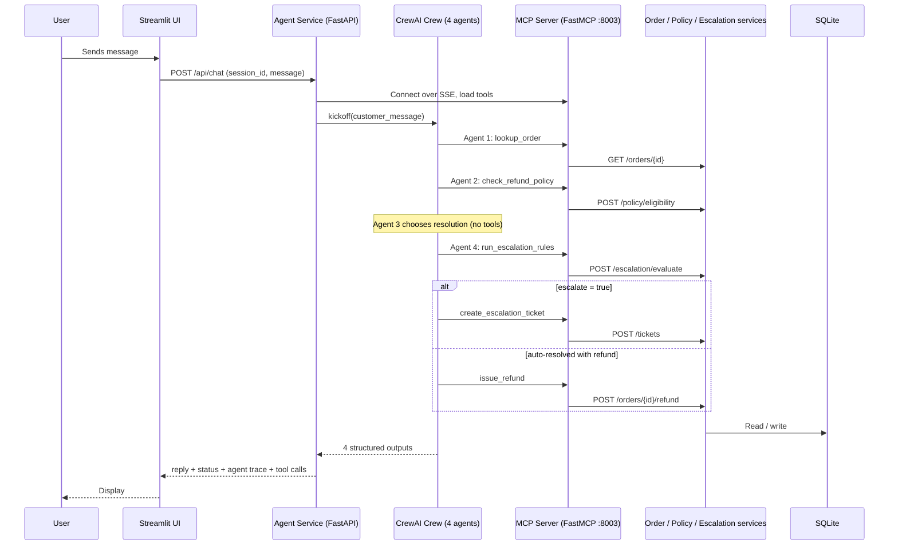

# Architecture Overview

ShopKart AI Customer Care is a distributed microservices system for e-commerce order, refund and exception
handling. It uses **CrewAI** for multi-agent orchestration, **FastMCP** to serve tools, **FastAPI** for the
backend microservices, **Streamlit** for the frontend and **SQLite** for data.

**Goal:** fast resolutions while enforcing business policy consistently, with risky cases routed to a human.

## System Components

| Service | Port | Responsibility |
|---|---|---|
| **Frontend** (Streamlit) | 8501 | Chat UI. Shows each reply's status, the agent handoffs, the MCP tool calls and the escalation queue. Talks only to the Agent Service. |
| **Agent Service** (FastAPI + CrewAI) | 8000 | Runs the 4-agent crew for each message (`POST /api/chat`). Loads tools from the MCP server and filters them per agent. Keeps short sessions for follow-ups. |
| **MCP Server** (FastMCP, SSE) | 8003 | Exposes 8 tools and is the single point of contact with the business services. Logs every tool call. |
| **Order Service** (FastAPI) | 8001 | Orders and customers; executes refunds and refuses any automatic refund above ₹10,000. |
| **Policy Service** (FastAPI) | 8002 | The refund policy as text, and rules R1–R9 as code (`POST /policy/eligibility`). |
| **Escalation Service** (FastAPI) | 8004 | The escalation rules (`POST /escalation/evaluate`) and the human review queue (`/tickets`). |

The knowledge source is **not RAG**: policy and mock data are static rules and seeded SQLite tables.

## The Agents

| Agent | Goal | MCP tools | Input → Output (handoff format) |
|---|---|---|---|
| **1. Order Issue Identification** | Find the order and classify the issue with an honest confidence score | `lookup_order` | Customer message → `IssueReport` (order_id, issue_type from 7 fixed values, customer_request, sentiment, safety_or_legal_concern, confidence, summary) |
| **2. Policy Interpretation** | State exactly what the policy allows | `check_refund_policy` | IssueReport → `PolicyAssessment` (eligible, rule_id, allowed_resolutions, max_refund_inr, conditions, exception_possible, investigation_required) |
| **3. Resolution Recommendation** | Choose the best allowed resolution and draft the reply | none | IssueReport + PolicyAssessment → `ResolutionPlan` (action, refund_amount_inr, customer_reply_draft) |
| **4. Escalation** | Decide auto-close vs human approval and write the final reply | `run_escalation_rules` | All three → `EscalationDecision` (escalate, priority, triggered_rules, route_to, final_status, final_customer_message) |
| **Action step (code)** | Re-check the rules, then take exactly one action | `create_escalation_ticket` or `issue_refund` | Ticket reference or refund confirmation appended to the reply |

Responsibilities are deliberately narrow: Agent 1 never quotes policy, Agent 2 never writes to the customer,
Agent 3 cannot exceed the policy's maximum refund and has no tools. No agent can open a ticket or move money:
after the crew finishes, `execute_action()` in `agent/crew.py` re-runs the escalation rules (correcting Agent 4 if it
miscopied them) and performs exactly one action. A guardrail on Agent 1 removes any order ID that does not appear in
the customer's message, so a vague message is routed to NEEDS_INFO instead of acting on a guessed order.

## Task Flow and Handoffs

The crew runs as `Process.sequential`. Each task declares `context=[...]` on the earlier tasks, so every agent
depends on the previous agents' **typed Pydantic outputs**, not on free text:

```
identify_task ──► policy_task ──► resolution_task ──► escalation_task
      └───────────────┴──────────────────┴────────────────► (Agent 4 sees all three)
```

### Conditional routing

| Condition | Route | Outcome |
|---|---|---|
| No valid order (policy rule R0) | Identify → Policy → **skip Resolution** → Escalation | NEEDS_INFO: ask for the order ID; the next message completes the case |
| Any escalation rule fires | All four agents; code opens one ticket | ESCALATED: ticket routed by priority, no refund promised |
| Eligible, no rule fires | All four agents; code issues one refund when money is due (capped at the policy maximum) | AUTO_RESOLVED |
| Not eligible under policy | All four agents; no action tool called | DENIED: polite explanation citing the rule |

The first route is a CrewAI `ConditionalTask`: `resolution_task` runs only when `order_was_found()` returns
true for Agent 2's `PolicyAssessment` (see `agent/crew.py`). The other routes are decided by the escalation
rules and carried out by Agent 4.



## Escalation Logic

Escalation is computed by a deterministic rule engine in the Escalation Service. Agent 4 must call it and copy
its result; it can never downgrade an escalation.

| Rule | Trigger | Priority → Team (SLA) |
|---|---|---|
| ESC_SAFETY | Fire, smoke, burn, shock or injury mentioned | P1 → Trust & Safety / Legal (4 h) |
| ESC_LEGAL | Consumer court, lawyer, legal notice, police | P1 → Trust & Safety / Legal (4 h) |
| ESC_FRAUD_HISTORY | 3 or more refund claims in 90 days | P2 → Fraud & Risk (24 h) |
| ESC_NOT_RECEIVED | Marked delivered but reported not received (R7) | P2 → Fraud & Risk (24 h) |
| ESC_HIGH_VALUE | Proposed refund above ₹10,000 (R9) | P3 → Refund Approvals (24 h) |
| ESC_POLICY_EXCEPTION | Gold customer ≤ 3 days outside a return window (R6) | P3 → Refund Approvals (24 h) |
| ESC_LOW_CONFIDENCE | Agent 1 confidence < 0.70 (order found) | P4 → Senior Support (48 h) |

If several rules fire, the most urgent priority wins and all reasons are kept. With no rule fired, the status is
**AUTO_RESOLVED**, or **DENIED** when the policy says no, or **NEEDS_INFO** when no valid order was found.
Escalated replies give the ticket reference and SLA, and never promise an outcome a human still has to approve.

**Defence in depth:** even if an agent tried to refund ₹62,000, the Order Service refuses any automatic refund
above ₹10,000.

## Sample Inputs & Outputs

| # | Customer message (short) | Expected | Why | Actual result |
|---|---|---|---|---|
| C01 | ORD1001 headphones faulty, wants refund | AUTO_RESOLVED + ₹2,499 refund | R1, within 7 days | |
| C02 | ORD1002 kurta too tight, return | AUTO_RESOLVED | R3, 12 of 30 days; refund after pickup | |
| C03 | ORD1003 watch 5 days late | AUTO_RESOLVED + ₹99 refund | R5: shipping fee + ₹100 coupon | |
| C04 | ORD1004 laptop cracked screen | ESCALATED P3 | ₹62,000 > ₹10,000 limit | |
| C05 | ORD1005 phone "delivered" but not received | ESCALATED P2 | R7 investigation + 3 prior claims | |
| C06 | ORD1006 power bank smoking, burned hand | ESCALATED P1 | Safety hazard | |
| C07 | ORD1007 fruit basket, changed mind | DENIED | R4 grocery non-returnable (false-positive test) | |
| C08 | ORD1008 Gold member, shoes after a month | ESCALATED P3 | R6 goodwill exception, 2 days over | |
| C09 | ORD1009 wrong book, threatens consumer court | ESCALATED P1 | Legal threat | |
| C10 | "my thing came and its not right" | NEEDS_INFO | No order ID (false-positive test) | |

*Fill "Actual result" by running `python tests/run_samples.py`; it also writes the full replies and agent
handoffs to `outputs/sample_outputs.md`. Paste one auto-resolved and one escalated reply here.*

## Design Rationale

- **LLM for language, code for rules.** Agents interpret messages and write replies; dates, money and
  thresholds are computed by the Policy and Escalation services. The same complaint always gets the same
  decision, and every decision cites a rule ID that can be audited.
- **Structured handoffs.** Pydantic models with fixed `Literal` values remove ambiguity between agents and make
  every step inspectable in the UI and testable in `tests/run_samples.py`.
- **MCP as the tool boundary.** Agents never call services directly. Tools are discovered from the MCP server
  and filtered per agent (least privilege), so only Agent 4 can create tickets or issue refunds.
- **Escalation as a deliberate gate.** Explicit thresholds and priorities replace a vague "escalate if needed".
  The rules lean towards safety: a false positive costs some human time, while a false negative on fraud,
  safety or a ₹60,000 refund costs far more.
- **Testing both error types.** The sample set includes cases that must escalate and cases that must not
  (C07, C10), and the test script reports false positives and false negatives.
- **Known limitations:** keyword matching can over-trigger (for example "I was shocked by the price"); a
  production system would add an LLM safety classifier as a second signal. Sessions are in memory, and each
  service keeps its own SQLite copy, so data resets when containers are recreated.
